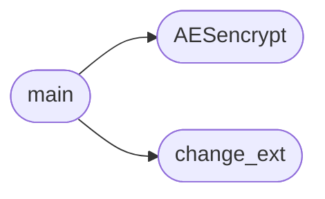

# `crypter`

> Source: [crypter.py:1](../../crypter.py#L1) | language `py` | coverage 25.0% | [API index](../index.md)

## Contents

- **Functions:** [`AESencrypt`](#aesencrypt), [`change_ext`](#change_ext), [`main`](#main)

## Call Graph

Solid arrows stay in this module, dashed arrows leave it.



## Functions

<a id="aesencrypt"></a>

### `AESencrypt`

`function` | [crypter.py:9](../../crypter.py#L9)

```python
def AESencrypt(plaintext, key)
```

**Parameters**

| Name | Type | Default | Description |
|---|---|---|---|
| `plaintext` |  |  |  |
| `key` |  |  |  |

*Called by:* [`main`](#main)

---

<a id="change_ext"></a>

### `change_ext`

`function` | [crypter.py:19](../../crypter.py#L19)

```python
def change_ext(filename, new_ext)
```

Reemplaza la extensión del archivo por una nueva (sin el punto).

**Parameters**

| Name | Type | Default | Description |
|---|---|---|---|
| `filename` |  |  |  |
| `new_ext` |  |  |  |

*Called by:* [`main`](#main)

---

<a id="main"></a>

### `main`

`function` | [crypter.py:24](../../crypter.py#L24)

```python
def main()
```

*Calls:* [`AESencrypt`](#aesencrypt), [`change_ext`](#change_ext)

---
