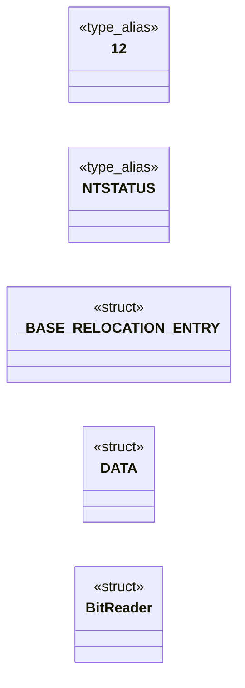
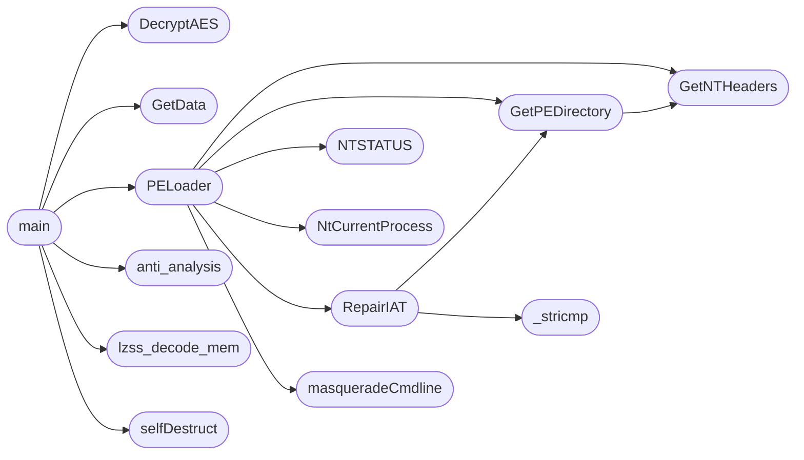

# `loader.c`

> Source: [loader.c:1](../../loader.c#L1) | language `c` | coverage 14.3% | [API index](../index.md)

## Contents

- **Structs:** [`_BASE_RELOCATION_ENTRY`](#_base_relocation_entry), [`DATA`](#data), [`BitReader`](#bitreader)
- **Type Aliases:** [`NTSTATUS`](#ntstatus), [`12`](#12)
- **Functions:** [`lzss_decode_mem`](#lzss_decode_mem), [`hookGetCommandLineW`](#hookgetcommandlinew), [`hookGetCommandLineA`](#hookgetcommandlinea), [`hook__p___argv`](#hook__p___argv), [`hook__p___wargv`](#hook__p___wargv), [`hook__p___argc`](#hook__p___argc), [`anti_analysis`](#anti_analysis), [`selfDestruct`](#selfdestruct), [`hook__wgetmainargs`](#hook__wgetmainargs), [`hook__getmainargs`](#hook__getmainargs), [`hookexit`](#hookexit), [`hookExitProcess`](#hookexitprocess), [`masqueradeCmdline`](#masqueradecmdline), [`freeargvA`](#freeargva), [`freeargvW`](#freeargvw), [`GetNTHeaders`](#getntheaders), [`GetPEDirectory`](#getpedirectory), [`RepairIAT`](#repairiat), [`_stricmp`](#_stricmp), [`RunPE`](#runpe), [`PELoader`](#peloader), [`getNtdll`](#getntdll), [`Unhook`](#unhook), [`DecryptAES`](#decryptaes), [`GetData`](#getdata), [`main`](#main)
- **Macros:** [`_CRT_RAND_S`](#_crt_rand_s), [`NT_SUCCESS`](#nt_success), [`NtCurrentThread`](#ntcurrentthread), [`NtCurrentProcess`](#ntcurrentprocess), [`_CRT_SECURE_NO_WARNINGS`](#_crt_secure_no_warnings), [`EI`](#ei), [`EJ`](#ej), [`P`](#p), [`N`](#n), [`F`](#f)

## Type Diagram



## Call Graph

Solid arrows stay in this module, dashed arrows leave it.



## Structs

<a id="_base_relocation_entry"></a>

### `_BASE_RELOCATION_ENTRY`

`struct` | [loader.c:41](../../loader.c#L41)

```c
typedef struct _BASE_RELOCATION_ENTRY
```

---

<a id="data"></a>

### `DATA`

`struct` | [loader.c:46](../../loader.c#L46)

```c
typedef struct
```

---

<a id="bitreader"></a>

### `BitReader`

`struct` | [loader.c:58](../../loader.c#L58)

```c
typedef struct
```

---

## Type Aliases

<a id="ntstatus"></a>

### `NTSTATUS`

`type_alias` | [loader.c:38](../../loader.c#L38)

```c
typedef LONG NTSTATUS;
```

pragma warning(disable: 4996) define _CRT_SECURE_NO_WARNINGS

---

<a id="12"></a>

### `12`

`type_alias` | [loader.c:40](../../loader.c#L40)

```c
typedef struct _BASE_RELOCATION_ENTRY { WORD Offset : 12;
```

---

## Functions

<a id="lzss_decode_mem"></a>

### `lzss_decode_mem`

`function` | [loader.c:85](../../loader.c#L85)

```c
BOOL lzss_decode_mem(const unsigned char* input, size_t input_size, unsigned char** output, size_t* output_size)
```

**Parameters**

| Name | Type | Default | Description |
|---|---|---|---|
| `input` | `unsigned char*` |  |  |
| `input_size` | `size_t` |  |  |
| `output` | `unsigned char**` |  |  |
| `output_size` | `size_t*` |  |  |

**Returns:** `BOOL`

*Called by:* [`main`](#main)

---

<a id="hookgetcommandlinew"></a>

### `hookGetCommandLineW`

`function` | [loader.c:217](../../loader.c#L217)

```c
LPWSTR hookGetCommandLineW()
```

Implementación de hooks

**Returns:** `LPWSTR`

---

<a id="hookgetcommandlinea"></a>

### `hookGetCommandLineA`

`function` | [loader.c:218](../../loader.c#L218)

```c
LPSTR hookGetCommandLineA()
```

**Returns:** `LPSTR`

---

<a id="hook__p___argv"></a>

### `hook__p___argv`

`function` | [loader.c:219](../../loader.c#L219)

```c
char*** __cdecl hook__p___argv(void)
```

**Returns:** `char*** __cdecl`

---

<a id="hook__p___wargv"></a>

### `hook__p___wargv`

`function` | [loader.c:220](../../loader.c#L220)

```c
wchar_t*** __cdecl hook__p___wargv(void)
```

**Returns:** `wchar_t*** __cdecl`

---

<a id="hook__p___argc"></a>

### `hook__p___argc`

`function` | [loader.c:221](../../loader.c#L221)

```c
int* __cdecl hook__p___argc(void)
```

**Returns:** `int* __cdecl`

---

<a id="anti_analysis"></a>

### `anti_analysis`

`function` | [loader.c:226](../../loader.c#L226)

```c
BOOL anti_analysis()
```

=== ANTI-ANALYSIS ===

**Returns:** `BOOL`

*Called by:* [`main`](#main)

---

<a id="selfdestruct"></a>

### `selfDestruct`

`function` | [loader.c:251](../../loader.c#L251)

```c
void selfDestruct()
```

Puff

*Called by:* [`main`](#main)

---

<a id="hook__wgetmainargs"></a>

### `hook__wgetmainargs`

`function` | [loader.c:307](../../loader.c#L307)

```c
int hook__wgetmainargs(int* _Argc, wchar_t*** _Argv, wchar_t*** _Env, int _useless_, void* _useless)
```

**Parameters**

| Name | Type | Default | Description |
|---|---|---|---|
| `_Argc` | `int*` |  |  |
| `_Argv` | `wchar_t***` |  |  |
| `_Env` | `wchar_t***` |  |  |
| `_useless_` | `int` |  |  |
| `_useless` | `void*` |  |  |

**Returns:** `int`

---

<a id="hook__getmainargs"></a>

### `hook__getmainargs`

`function` | [loader.c:313](../../loader.c#L313)

```c
int hook__getmainargs(int* _Argc, char*** _Argv, char*** _Env, int _useless_, void* _useless)
```

**Parameters**

| Name | Type | Default | Description |
|---|---|---|---|
| `_Argc` | `int*` |  |  |
| `_Argv` | `char***` |  |  |
| `_Env` | `char***` |  |  |
| `_useless_` | `int` |  |  |
| `_useless` | `void*` |  |  |

**Returns:** `int`

---

<a id="hookexit"></a>

### `hookexit`

`function` | [loader.c:319](../../loader.c#L319)

```c
int __cdecl hookexit(int status)
```

**Parameters**

| Name | Type | Default | Description |
|---|---|---|---|
| `status` | `int` |  |  |

**Returns:** `int __cdecl`

---

<a id="hookexitprocess"></a>

### `hookExitProcess`

`function` | [loader.c:324](../../loader.c#L324)

```c
void __stdcall hookExitProcess(UINT statuscode)
```

**Parameters**

| Name | Type | Default | Description |
|---|---|---|---|
| `statuscode` | `UINT` |  |  |

**Returns:** `void __stdcall`

---

<a id="masqueradecmdline"></a>

### `masqueradeCmdline`

`function` | [loader.c:328](../../loader.c#L328)

```c
void masqueradeCmdline()
```

*Called by:* [`PELoader`](#peloader)

---

<a id="freeargva"></a>

### `freeargvA`

`function` | [loader.c:366](../../loader.c#L366)

```c
void freeargvA(char** array, int Argc)
```

**Parameters**

| Name | Type | Default | Description |
|---|---|---|---|
| `array` | `char**` |  |  |
| `Argc` | `int` |  |  |

---

<a id="freeargvw"></a>

### `freeargvW`

`function` | [loader.c:374](../../loader.c#L374)

```c
void freeargvW(wchar_t** array, int Argc)
```

**Parameters**

| Name | Type | Default | Description |
|---|---|---|---|
| `array` | `wchar_t**` |  |  |
| `Argc` | `int` |  |  |

---

<a id="getntheaders"></a>

### `GetNTHeaders`

`function` | [loader.c:382](../../loader.c#L382)

```c
char* GetNTHeaders(char* pe_buffer)
```

**Parameters**

| Name | Type | Default | Description |
|---|---|---|---|
| `pe_buffer` | `char*` |  |  |

**Returns:** `char*`

*Called by:* [`GetPEDirectory`](#getpedirectory), [`PELoader`](#peloader)

---

<a id="getpedirectory"></a>

### `GetPEDirectory`

`function` | [loader.c:394](../../loader.c#L394)

```c
IMAGE_DATA_DIRECTORY* GetPEDirectory(PVOID pe_buffer, size_t dir_id)
```

**Parameters**

| Name | Type | Default | Description |
|---|---|---|---|
| `pe_buffer` | `PVOID` |  |  |
| `dir_id` | `size_t` |  |  |

**Returns:** `IMAGE_DATA_DIRECTORY*`

*Calls:* [`GetNTHeaders`](#getntheaders)

*Called by:* [`PELoader`](#peloader), [`RepairIAT`](#repairiat)

---

<a id="repairiat"></a>

### `RepairIAT`

`function` | [loader.c:404](../../loader.c#L404)

```c
BOOL RepairIAT(PVOID modulePtr)
```

**Parameters**

| Name | Type | Default | Description |
|---|---|---|---|
| `modulePtr` | `PVOID` |  |  |

**Returns:** `BOOL`

*Calls:* [`GetPEDirectory`](#getpedirectory), [`_stricmp`](#_stricmp)

*Called by:* [`PELoader`](#peloader)

---

<a id="_stricmp"></a>

### `_stricmp`

`function` | [loader.c:458](../../loader.c#L458)

```c
_stricmp(func_name, "exit") == 0 || _stricmp(func_name, "_Exit") == 0 || ...
```

**Parameters**

| Name | Type | Default | Description |
|---|---|---|---|
| `exit` |  |  |  |

*Called by:* [`RepairIAT`](#repairiat), [`RepairIAT`](loader2.c.md#repairiat), [`RepairIAT`](loader3.c.md#repairiat), [`RepairIAT`](loader4.c.md#repairiat), [`RepairIAT`](loader5.c.md#repairiat), [`RepairIAT`](loader6.c.md#repairiat)

---

<a id="runpe"></a>

### `RunPE`

`function` | [loader.c:479](../../loader.c#L479)

```c
DWORD WINAPI RunPE(LPVOID lpParameter)
```

**Parameters**

| Name | Type | Default | Description |
|---|---|---|---|
| `lpParameter` | `LPVOID` |  |  |

**Returns:** `DWORD WINAPI`

---

<a id="peloader"></a>

### `PELoader`

`function` | [loader.c:485](../../loader.c#L485)

```c
void PELoader(char* data, DWORD datasize)
```

**Parameters**

| Name | Type | Default | Description |
|---|---|---|---|
| `data` | `char*` |  |  |
| `datasize` | `DWORD` |  |  |

*Calls:* [`GetNTHeaders`](#getntheaders), [`GetPEDirectory`](#getpedirectory), [`NTSTATUS`](#ntstatus), [`NtCurrentProcess`](#ntcurrentprocess), [`RepairIAT`](#repairiat), [`masqueradeCmdline`](#masqueradecmdline)

*Called by:* [`main`](#main)

---

<a id="getntdll"></a>

### `getNtdll`

`function` | [loader.c:559](../../loader.c#L559)

```c
LPVOID getNtdll()
```

**Returns:** `LPVOID`

---

<a id="unhook"></a>

### `Unhook`

`function` | [loader.c:602](../../loader.c#L602)

```c
BOOL Unhook(LPVOID cleanNtdll)
```

**Parameters**

| Name | Type | Default | Description |
|---|---|---|---|
| `cleanNtdll` | `LPVOID` |  |  |

**Returns:** `BOOL`

---

<a id="decryptaes"></a>

### `DecryptAES`

`function` | [loader.c:638](../../loader.c#L638)

```c
void DecryptAES(char* data, DWORD* pDataLen, char* key, DWORD keyLen)
```

**Parameters**

| Name | Type | Default | Description |
|---|---|---|---|
| `data` | `char*` |  |  |
| `pDataLen` | `DWORD*` |  |  |
| `key` | `char*` |  |  |
| `keyLen` | `DWORD` |  |  |

*Called by:* [`main`](#main)

---

<a id="getdata"></a>

### `GetData`

`function` | [loader.c:671](../../loader.c#L671)

```c
DATA GetData(wchar_t* whost, DWORD port, wchar_t* wresource)
```

**Parameters**

| Name | Type | Default | Description |
|---|---|---|---|
| `whost` | `wchar_t*` |  |  |
| `port` | `DWORD` |  |  |
| `wresource` | `wchar_t*` |  |  |

**Returns:** `DATA`

*Called by:* [`main`](#main)

---

<a id="main"></a>

### `main`

`function` | [loader.c:792](../../loader.c#L792)

```c
int main(int argc, char** argv)
```

**Parameters**

| Name | Type | Default | Description |
|---|---|---|---|
| `argc` | `int` |  |  |
| `argv` | `char**` |  |  |

**Returns:** `int`

*Calls:* [`DecryptAES`](#decryptaes), [`GetData`](#getdata), [`PELoader`](#peloader), [`anti_analysis`](#anti_analysis), [`lzss_decode_mem`](#lzss_decode_mem), [`selfDestruct`](#selfdestruct)

---

## Macros

<a id="_crt_rand_s"></a>

### `_CRT_RAND_S`

`macro` | [loader.c:19](../../loader.c#L19)

```c
#define _CRT_RAND_S
```

This file is part of Black Basalt Beacon.

Black Basalt Beacon is free software: you can't redistribute it and/or modify
it under the terms of our private License as published by
the LazyOwn RedTeam, either version 1 of the License, or
(at your option) any later version.

Black Basalt Beacon BOF LazyLoader is distributed in the hope that it will be useful,
but WITHOUT ANY WARRANTY; without even the implied warranty of
MERCHANTABILITY or FITNESS FOR A PARTICULAR PURPOSE.  See the
License for more details.

You should have received a copy of the icense
along with Black Basalt Beacon BOF LazyLoader.  If not, see <https://lazyown.ct.ws/>.

Copyright (c) LazyOwn RedTeam 2025. All rights reserved.

---

<a id="nt_success"></a>

### `NT_SUCCESS`

`macro` | [loader.c:30](../../loader.c#L30)

```c
#define NT_SUCCESS(Status)
```

---

<a id="ntcurrentthread"></a>

### `NtCurrentThread`

`macro` | [loader.c:33](../../loader.c#L33)

```c
#define NtCurrentThread()
```

---

<a id="ntcurrentprocess"></a>

### `NtCurrentProcess`

`macro` | [loader.c:34](../../loader.c#L34)

```c
#define NtCurrentProcess()
```

*Called by:* [`PELoader`](#peloader)

---

<a id="_crt_secure_no_warnings"></a>

### `_CRT_SECURE_NO_WARNINGS`

`macro` | [loader.c:37](../../loader.c#L37)

```c
#define _CRT_SECURE_NO_WARNINGS
```

---

<a id="ei"></a>

### `EI`

`macro` | [loader.c:52](../../loader.c#L52)

```c
#define EI
```

=== LZSS DECOMPRESSOR (Okumura - in memory) ===

---

<a id="ej"></a>

### `EJ`

`macro` | [loader.c:53](../../loader.c#L53)

```c
#define EJ
```

---

<a id="p"></a>

### `P`

`macro` | [loader.c:54](../../loader.c#L54)

```c
#define P
```

---

<a id="n"></a>

### `N`

`macro` | [loader.c:55](../../loader.c#L55)

```c
#define N
```

---

<a id="f"></a>

### `F`

`macro` | [loader.c:56](../../loader.c#L56)

```c
#define F
```

---
