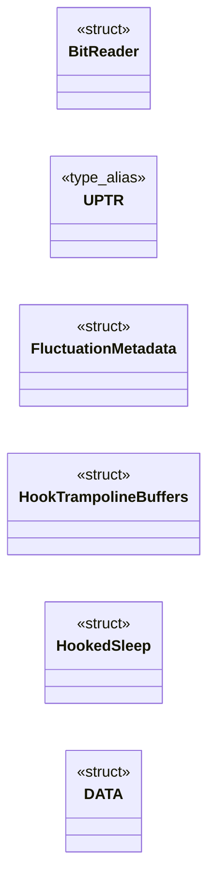
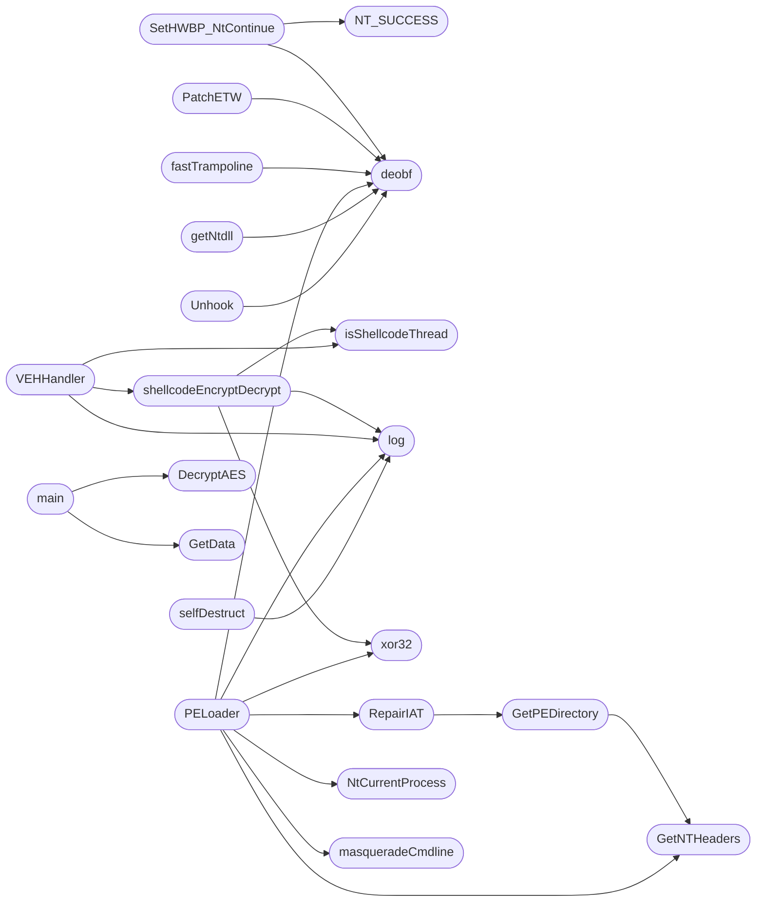

# `loader4.c`

> Source: [loader4.c:1](../../loader4.c#L1) | language `c` | coverage 24.6% | [API index](../index.md)

## Contents

- **Structs:** [`BitReader`](#bitreader), [`FluctuationMetadata`](#fluctuationmetadata), [`HookTrampolineBuffers`](#hooktrampolinebuffers), [`HookedSleep`](#hookedsleep), [`DATA`](#data)
- **Type Aliases:** [`UPTR`](#uptr), [`UPTR`](#uptr)
- **Functions:** [`deobf`](#deobf), [`SetHWBP_NtContinue`](#sethwbp_ntcontinue), [`lzss_decode_mem`](#lzss_decode_mem), [`PatchETW`](#patchetw), [`DecryptAES`](#decryptaes), [`xor32`](#xor32), [`isShellcodeThread`](#isshellcodethread), [`shellcodeEncryptDecrypt`](#shellcodeencryptdecrypt), [`fastTrampoline`](#fasttrampoline), [`VEHHandler`](#vehhandler), [`masqueradeCmdline`](#masqueradecmdline), [`freeargvA`](#freeargva), [`freeargvW`](#freeargvw), [`GetNTHeaders`](#getntheaders), [`GetPEDirectory`](#getpedirectory), [`RepairIAT`](#repairiat), [`hookGetCommandLineA`](#hookgetcommandlinea), [`hookGetCommandLineW`](#hookgetcommandlinew), [`hook__p___argv`](#hook__p___argv), [`hook__p___wargv`](#hook__p___wargv), [`hook__p___argc`](#hook__p___argc), [`hook__getmainargs`](#hook__getmainargs), [`hook__wgetmainargs`](#hook__wgetmainargs), [`hookexit`](#hookexit), [`hookExitProcess`](#hookexitprocess), [`RunPE`](#runpe), [`PELoader`](#peloader), [`anti_analysis`](#anti_analysis), [`selfDestruct`](#selfdestruct), [`getNtdll`](#getntdll), [`Unhook`](#unhook), [`GetData`](#getdata), [`main`](#main)
- **Macros:** [`_CRT_RAND_S`](#_crt_rand_s), [`WIN32_LEAN_AND_MEAN`](#win32_lean_and_mean), [`XK`](#xk), [`_CRT_SECURE_NO_WARNINGS`](#_crt_secure_no_warnings), [`NT_SUCCESS`](#nt_success), [`NtCurrentThread`](#ntcurrentthread), [`NtCurrentProcess`](#ntcurrentprocess), [`EI`](#ei), [`EJ`](#ej), [`P`](#p), [`N`](#n), [`F`](#f), [`OBFUSCATE_KEY`](#obfuscate_key), [`OBFSTR`](#obfstr), [`OBFSTRW`](#obfstrw), [`log`](#log)

## Type Diagram



## Call Graph

Solid arrows stay in this module, dashed arrows leave it.



## Structs

<a id="bitreader"></a>

### `BitReader`

`struct` | [loader4.c:98](../../loader4.c#L98)

```c
typedef struct
```

---

<a id="fluctuationmetadata"></a>

### `FluctuationMetadata`

`struct` | [loader4.c:287](../../loader4.c#L287)

```c
typedef struct
```

---

<a id="hooktrampolinebuffers"></a>

### `HookTrampolineBuffers`

`struct` | [loader4.c:295](../../loader4.c#L295)

```c
typedef struct
```

---

<a id="hookedsleep"></a>

### `HookedSleep`

`struct` | [loader4.c:305](../../loader4.c#L305)

```c
typedef struct
```

---

<a id="data"></a>

### `DATA`

`struct` | [loader4.c:310](../../loader4.c#L310)

```c
typedef struct
```

---

## Type Aliases

<a id="uptr"></a>

### `UPTR`

`type_alias` | [loader4.c:276](../../loader4.c#L276)

```c
typedef UINT64 UPTR;
```

================== TYPEDEFS & STRUCTS ================== ifdef _WIN64

---

<a id="uptr"></a>

### `UPTR`

`type_alias` | [loader4.c:278](../../loader4.c#L278)

```c
typedef UINT32 UPTR;
```

else

---

## Functions

<a id="deobf"></a>

### `deobf`

`function` | [loader4.c:124](../../loader4.c#L124)

```c
void deobf(const char* src, char* dst, size_t max_len)
```

Helper para desofuscar

**Parameters**

| Name | Type | Default | Description |
|---|---|---|---|
| `src` | `char*` |  |  |
| `dst` | `char*` |  |  |
| `max_len` | `size_t` |  |  |

*Called by:* [`PELoader`](#peloader), [`PatchETW`](#patchetw), [`SetHWBP_NtContinue`](#sethwbp_ntcontinue), [`Unhook`](#unhook), [`fastTrampoline`](#fasttrampoline), [`getNtdll`](#getntdll)

---

<a id="sethwbp_ntcontinue"></a>

### `SetHWBP_NtContinue`

`function` | [loader4.c:132](../../loader4.c#L132)

```c
BOOL SetHWBP_NtContinue(PVOID targetAddr, DWORD index)
```

**Parameters**

| Name | Type | Default | Description |
|---|---|---|---|
| `targetAddr` | `PVOID` |  |  |
| `index` | `DWORD` |  |  |

**Returns:** `BOOL`

*Calls:* [`NT_SUCCESS`](#nt_success), [`deobf`](#deobf)

*Called by:* [`main`](#main)

---

<a id="lzss_decode_mem"></a>

### `lzss_decode_mem`

`function` | [loader4.c:163](../../loader4.c#L163)

```c
BOOL lzss_decode_mem(const unsigned char* input, size_t input_size, unsigned char** output, size_t* output_size)
```

**Parameters**

| Name | Type | Default | Description |
|---|---|---|---|
| `input` | `unsigned char*` |  |  |
| `input_size` | `size_t` |  |  |
| `output` | `unsigned char**` |  |  |
| `output_size` | `size_t*` |  |  |

**Returns:** `BOOL`

*Called by:* [`main`](#main)

---

<a id="patchetw"></a>

### `PatchETW`

`function` | [loader4.c:219](../../loader4.c#L219)

```c
BOOL PatchETW()
```

**Returns:** `BOOL`

*Calls:* [`deobf`](#deobf)

*Called by:* [`main`](#main)

---

<a id="decryptaes"></a>

### `DecryptAES`

`function` | [loader4.c:252](../../loader4.c#L252)

```c
void DecryptAES(char* data, DWORD* pDataLen, char* key, DWORD keyLen)
```

**Parameters**

| Name | Type | Default | Description |
|---|---|---|---|
| `data` | `char*` |  |  |
| `pDataLen` | `DWORD*` |  |  |
| `key` | `char*` |  |  |
| `keyLen` | `DWORD` |  |  |

*Called by:* [`main`](#main)

---

<a id="xor32"></a>

### `xor32`

`function` | [loader4.c:355](../../loader4.c#L355)

```c
void xor32(uint8_t *buf, SIZE_T sz, uint32_t key)
```

**Parameters**

| Name | Type | Default | Description |
|---|---|---|---|
| `buf` | `uint8_t *` |  |  |
| `sz` | `SIZE_T` |  |  |
| `key` | `uint32_t` |  |  |

*Called by:* [`PELoader`](#peloader), [`shellcodeEncryptDecrypt`](#shellcodeencryptdecrypt)

---

<a id="isshellcodethread"></a>

### `isShellcodeThread`

`function` | [loader4.c:362](../../loader4.c#L362)

```c
bool isShellcodeThread(LPVOID addr)
```

**Parameters**

| Name | Type | Default | Description |
|---|---|---|---|
| `addr` | `LPVOID` |  |  |

**Returns:** `bool`

*Called by:* [`VEHHandler`](#vehhandler), [`shellcodeEncryptDecrypt`](#shellcodeencryptdecrypt)

---

<a id="shellcodeencryptdecrypt"></a>

### `shellcodeEncryptDecrypt`

`function` | [loader4.c:371](../../loader4.c#L371)

```c
void shellcodeEncryptDecrypt(LPVOID caller)
```

**Parameters**

| Name | Type | Default | Description |
|---|---|---|---|
| `caller` | `LPVOID` |  |  |

*Calls:* [`isShellcodeThread`](#isshellcodethread), [`log`](#log), [`xor32`](#xor32)

*Called by:* [`VEHHandler`](#vehhandler)

---

<a id="fasttrampoline"></a>

### `fastTrampoline`

`function` | [loader4.c:419](../../loader4.c#L419)

```c
bool fastTrampoline(bool install, BYTE *target, LPVOID jump, HookTrampolineBuffers *b)
```

**Parameters**

| Name | Type | Default | Description |
|---|---|---|---|
| `install` | `bool` |  |  |
| `target` | `BYTE *` |  |  |
| `jump` | `LPVOID` |  |  |
| `b` | `HookTrampolineBuffers *` |  |  |

**Returns:** `bool`

*Calls:* [`deobf`](#deobf)

*Called by:* [`main`](#main)

---

<a id="vehhandler"></a>

### `VEHHandler`

`function` | [loader4.c:458](../../loader4.c#L458)

```c
LONG NTAPI VEHHandler(PEXCEPTION_POINTERS xp)
```

**Parameters**

| Name | Type | Default | Description |
|---|---|---|---|
| `xp` | `PEXCEPTION_POINTERS` |  |  |

**Returns:** `LONG NTAPI`

*Calls:* [`isShellcodeThread`](#isshellcodethread), [`log`](#log), [`shellcodeEncryptDecrypt`](#shellcodeencryptdecrypt)

---

<a id="masqueradecmdline"></a>

### `masqueradeCmdline`

`function` | [loader4.c:476](../../loader4.c#L476)

```c
void masqueradeCmdline()
```

================== PE LOADER ==================

*Called by:* [`PELoader`](#peloader)

---

<a id="freeargva"></a>

### `freeargvA`

`function` | [loader4.c:506](../../loader4.c#L506)

```c
void freeargvA(char** array, int Argc)
```

**Parameters**

| Name | Type | Default | Description |
|---|---|---|---|
| `array` | `char**` |  |  |
| `Argc` | `int` |  |  |

---

<a id="freeargvw"></a>

### `freeargvW`

`function` | [loader4.c:514](../../loader4.c#L514)

```c
void freeargvW(wchar_t** array, int Argc)
```

**Parameters**

| Name | Type | Default | Description |
|---|---|---|---|
| `array` | `wchar_t**` |  |  |
| `Argc` | `int` |  |  |

---

<a id="getntheaders"></a>

### `GetNTHeaders`

`function` | [loader4.c:522](../../loader4.c#L522)

```c
char* GetNTHeaders(char* pe_buffer)
```

**Parameters**

| Name | Type | Default | Description |
|---|---|---|---|
| `pe_buffer` | `char*` |  |  |

**Returns:** `char*`

*Called by:* [`GetPEDirectory`](#getpedirectory), [`PELoader`](#peloader)

---

<a id="getpedirectory"></a>

### `GetPEDirectory`

`function` | [loader4.c:533](../../loader4.c#L533)

```c
IMAGE_DATA_DIRECTORY* GetPEDirectory(PVOID pe_buffer, size_t dir_id)
```

**Parameters**

| Name | Type | Default | Description |
|---|---|---|---|
| `pe_buffer` | `PVOID` |  |  |
| `dir_id` | `size_t` |  |  |

**Returns:** `IMAGE_DATA_DIRECTORY*`

*Calls:* [`GetNTHeaders`](#getntheaders)

*Called by:* [`RepairIAT`](#repairiat)

---

<a id="repairiat"></a>

### `RepairIAT`

`function` | [loader4.c:542](../../loader4.c#L542)

```c
BOOL RepairIAT(PVOID modulePtr)
```

**Parameters**

| Name | Type | Default | Description |
|---|---|---|---|
| `modulePtr` | `PVOID` |  |  |

**Returns:** `BOOL`

*Calls:* [`_stricmp`](loader.c.md#_stricmp), [`GetPEDirectory`](#getpedirectory)

*Called by:* [`PELoader`](#peloader)

---

<a id="hookgetcommandlinea"></a>

### `hookGetCommandLineA`

`function` | [loader4.c:594](../../loader4.c#L594)

```c
LPSTR hookGetCommandLineA()
```

Hooks

**Returns:** `LPSTR`

---

<a id="hookgetcommandlinew"></a>

### `hookGetCommandLineW`

`function` | [loader4.c:595](../../loader4.c#L595)

```c
LPWSTR hookGetCommandLineW()
```

**Returns:** `LPWSTR`

---

<a id="hook__p___argv"></a>

### `hook__p___argv`

`function` | [loader4.c:596](../../loader4.c#L596)

```c
char*** __cdecl hook__p___argv(void)
```

**Returns:** `char*** __cdecl`

---

<a id="hook__p___wargv"></a>

### `hook__p___wargv`

`function` | [loader4.c:597](../../loader4.c#L597)

```c
wchar_t*** __cdecl hook__p___wargv(void)
```

**Returns:** `wchar_t*** __cdecl`

---

<a id="hook__p___argc"></a>

### `hook__p___argc`

`function` | [loader4.c:598](../../loader4.c#L598)

```c
int* __cdecl hook__p___argc(void)
```

**Returns:** `int* __cdecl`

---

<a id="hook__getmainargs"></a>

### `hook__getmainargs`

`function` | [loader4.c:599](../../loader4.c#L599)

```c
int hook__getmainargs(int* _Argc, char*** _Argv, char*** _Env, int _useless_, void* _useless)
```

**Parameters**

| Name | Type | Default | Description |
|---|---|---|---|
| `_Argc` | `int*` |  |  |
| `_Argv` | `char***` |  |  |
| `_Env` | `char***` |  |  |
| `_useless_` | `int` |  |  |
| `_useless` | `void*` |  |  |

**Returns:** `int`

---

<a id="hook__wgetmainargs"></a>

### `hook__wgetmainargs`

`function` | [loader4.c:602](../../loader4.c#L602)

```c
int hook__wgetmainargs(int* _Argc, wchar_t*** _Argv, wchar_t*** _Env, int _useless_, void* _useless)
```

**Parameters**

| Name | Type | Default | Description |
|---|---|---|---|
| `_Argc` | `int*` |  |  |
| `_Argv` | `wchar_t***` |  |  |
| `_Env` | `wchar_t***` |  |  |
| `_useless_` | `int` |  |  |
| `_useless` | `void*` |  |  |

**Returns:** `int`

---

<a id="hookexit"></a>

### `hookexit`

`function` | [loader4.c:605](../../loader4.c#L605)

```c
int __cdecl hookexit(int status)
```

**Parameters**

| Name | Type | Default | Description |
|---|---|---|---|
| `status` | `int` |  |  |

**Returns:** `int __cdecl`

---

<a id="hookexitprocess"></a>

### `hookExitProcess`

`function` | [loader4.c:609](../../loader4.c#L609)

```c
void __stdcall hookExitProcess(UINT statuscode)
```

**Parameters**

| Name | Type | Default | Description |
|---|---|---|---|
| `statuscode` | `UINT` |  |  |

**Returns:** `void __stdcall`

---

<a id="runpe"></a>

### `RunPE`

`function` | [loader4.c:613](../../loader4.c#L613)

```c
DWORD WINAPI RunPE(LPVOID lpParameter)
```

**Parameters**

| Name | Type | Default | Description |
|---|---|---|---|
| `lpParameter` | `LPVOID` |  |  |

**Returns:** `DWORD WINAPI`

---

<a id="peloader"></a>

### `PELoader`

`function` | [loader4.c:619](../../loader4.c#L619)

```c
void PELoader(char* data, DWORD datasize)
```

**Parameters**

| Name | Type | Default | Description |
|---|---|---|---|
| `data` | `char*` |  |  |
| `datasize` | `DWORD` |  |  |

*Calls:* [`NTSTATUS`](loader.c.md#ntstatus), [`GetNTHeaders`](#getntheaders), [`NtCurrentProcess`](#ntcurrentprocess), [`RepairIAT`](#repairiat), [`deobf`](#deobf), [`log`](#log), [`masqueradeCmdline`](#masqueradecmdline), [`xor32`](#xor32)

*Called by:* [`main`](#main)

---

<a id="anti_analysis"></a>

### `anti_analysis`

`function` | [loader4.c:699](../../loader4.c#L699)

```c
BOOL anti_analysis()
```

================== ANTI-ANALYSIS & CLEANUP ==================

**Returns:** `BOOL`

*Called by:* [`main`](#main)

---

<a id="selfdestruct"></a>

### `selfDestruct`

`function` | [loader4.c:720](../../loader4.c#L720)

```c
void selfDestruct()
```

*Calls:* [`log`](#log)

*Called by:* [`main`](#main)

---

<a id="getntdll"></a>

### `getNtdll`

`function` | [loader4.c:747](../../loader4.c#L747)

```c
LPVOID getNtdll()
```

================== UNHOOKING ==================

**Returns:** `LPVOID`

*Calls:* [`deobf`](#deobf)

*Called by:* [`main`](#main)

---

<a id="unhook"></a>

### `Unhook`

`function` | [loader4.c:785](../../loader4.c#L785)

```c
BOOL Unhook(LPVOID cleanNtdll)
```

**Parameters**

| Name | Type | Default | Description |
|---|---|---|---|
| `cleanNtdll` | `LPVOID` |  |  |

**Returns:** `BOOL`

*Calls:* [`deobf`](#deobf)

*Called by:* [`main`](#main)

---

<a id="getdata"></a>

### `GetData`

`function` | [loader4.c:811](../../loader4.c#L811)

```c
DATA GetData(wchar_t* whost, DWORD port, wchar_t* wresource)
```

================== NETWORK ==================

**Parameters**

| Name | Type | Default | Description |
|---|---|---|---|
| `whost` | `wchar_t*` |  |  |
| `port` | `DWORD` |  |  |
| `wresource` | `wchar_t*` |  |  |

**Returns:** `DATA`

*Called by:* [`main`](#main)

---

<a id="main"></a>

### `main`

`function` | [loader4.c:879](../../loader4.c#L879)

```c
int main(int argc, char** argv)
```

================== MAIN ==================

**Parameters**

| Name | Type | Default | Description |
|---|---|---|---|
| `argc` | `int` |  |  |
| `argv` | `char**` |  |  |

**Returns:** `int`

*Calls:* [`DecryptAES`](#decryptaes), [`GetData`](#getdata), [`PELoader`](#peloader), [`PatchETW`](#patchetw), [`SetHWBP_NtContinue`](#sethwbp_ntcontinue), [`Unhook`](#unhook), [`anti_analysis`](#anti_analysis), [`fastTrampoline`](#fasttrampoline), [`getNtdll`](#getntdll), [`log`](#log), [`lzss_decode_mem`](#lzss_decode_mem), [`selfDestruct`](#selfdestruct)

---

## Macros

<a id="_crt_rand_s"></a>

### `_CRT_RAND_S`

`macro` | [loader4.c:16](../../loader4.c#L16)

```c
#define _CRT_RAND_S
```

---

<a id="win32_lean_and_mean"></a>

### `WIN32_LEAN_AND_MEAN`

`macro` | [loader4.c:17](../../loader4.c#L17)

```c
#define WIN32_LEAN_AND_MEAN
```

---

<a id="xk"></a>

### `XK`

`macro` | [loader4.c:42](../../loader4.c#L42)

```c
#define XK
```

---

<a id="_crt_secure_no_warnings"></a>

### `_CRT_SECURE_NO_WARNINGS`

`macro` | [loader4.c:52](../../loader4.c#L52)

```c
#define _CRT_SECURE_NO_WARNINGS
```

---

<a id="nt_success"></a>

### `NT_SUCCESS`

`macro` | [loader4.c:55](../../loader4.c#L55)

```c
#define NT_SUCCESS(Status)
```

*Called by:* [`SetHWBP_NtContinue`](#sethwbp_ntcontinue)

---

<a id="ntcurrentthread"></a>

### `NtCurrentThread`

`macro` | [loader4.c:58](../../loader4.c#L58)

```c
#define NtCurrentThread()
```

---

<a id="ntcurrentprocess"></a>

### `NtCurrentProcess`

`macro` | [loader4.c:59](../../loader4.c#L59)

```c
#define NtCurrentProcess()
```

*Called by:* [`PELoader`](#peloader)

---

<a id="ei"></a>

### `EI`

`macro` | [loader4.c:62](../../loader4.c#L62)

```c
#define EI
```

=== LZSS DECOMPRESSOR (Okumura - in memory) ===

---

<a id="ej"></a>

### `EJ`

`macro` | [loader4.c:63](../../loader4.c#L63)

```c
#define EJ
```

---

<a id="p"></a>

### `P`

`macro` | [loader4.c:64](../../loader4.c#L64)

```c
#define P
```

---

<a id="n"></a>

### `N`

`macro` | [loader4.c:65](../../loader4.c#L65)

```c
#define N
```

---

<a id="f"></a>

### `F`

`macro` | [loader4.c:66](../../loader4.c#L66)

```c
#define F
```

---

<a id="obfuscate_key"></a>

### `OBFUSCATE_KEY`

`macro` | [loader4.c:69](../../loader4.c#L69)

```c
#define OBFUSCATE_KEY
```

============ STRING OBFUSCATION (Compile-time) ============

---

<a id="obfstr"></a>

### `OBFSTR`

`macro` | [loader4.c:72](../../loader4.c#L72)

```c
#define OBFSTR(str)
```

Macro para ofuscar strings en compile-time

---

<a id="obfstrw"></a>

### `OBFSTRW`

`macro` | [loader4.c:85](../../loader4.c#L85)

```c
#define OBFSTRW(str)
```

Helper para wchar_t

---

<a id="log"></a>

### `log`

`macro` | [loader4.c:327](../../loader4.c#L327)

```c
#define log(...)
```

================== UTIL MACROS ==================

**Parameters**

| Name | Type | Default | Description |
|---|---|---|---|
| `...` |  |  |  |

*Called by:* [`PELoader`](#peloader), [`VEHHandler`](#vehhandler), [`main`](#main), [`selfDestruct`](#selfdestruct), [`shellcodeEncryptDecrypt`](#shellcodeencryptdecrypt)

---
