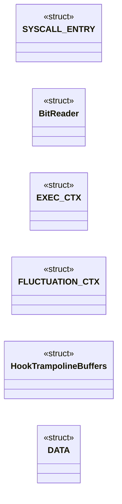
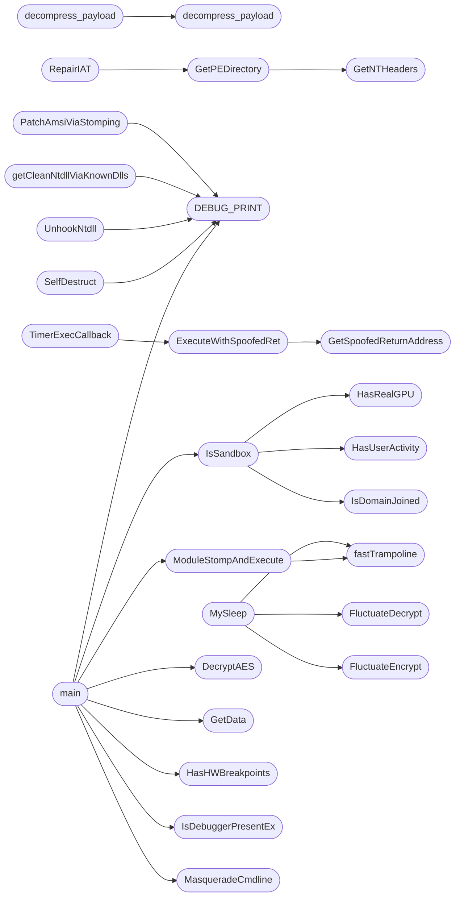

# `loader5.c`

> Source: [loader5.c:1](../../loader5.c#L1) | language `c` | coverage 23.6% | [API index](../index.md)

## Contents

- **Structs:** [`SYSCALL_ENTRY`](#syscall_entry), [`BitReader`](#bitreader), [`EXEC_CTX`](#exec_ctx), [`FLUCTUATION_CTX`](#fluctuation_ctx), [`HookTrampolineBuffers`](#hooktrampolinebuffers), [`DATA`](#data)
- **Functions:** [`HellGate`](#hellgate), [`decompress_payload`](#decompress_payload), [`decompress_payload`](#decompress_payload), [`DecryptAES`](#decryptaes), [`IsDebuggerPresentEx`](#isdebuggerpresentex), [`HasHWBreakpoints`](#hashwbreakpoints), [`IsDomainJoined`](#isdomainjoined), [`HasRealGPU`](#hasrealgpu), [`HasUserActivity`](#hasuseractivity), [`IsSandbox`](#issandbox), [`PatchAmsiViaStomping`](#patchamsiviastomping), [`getCleanNtdllViaKnownDlls`](#getcleanntdllviaknowndlls), [`UnhookNtdll`](#unhookntdll), [`MasqueradeCmdline`](#masqueradecmdline), [`hookGetCommandLineA`](#hookgetcommandlinea), [`hookGetCommandLineW`](#hookgetcommandlinew), [`hook__p___argv`](#hook__p___argv), [`hook__p___wargv`](#hook__p___wargv), [`hook__p___argc`](#hook__p___argc), [`hook__getmainargs`](#hook__getmainargs), [`hook__wgetmainargs`](#hook__wgetmainargs), [`hookexit`](#hookexit), [`hookExitProcess`](#hookexitprocess), [`GetNTHeaders`](#getntheaders), [`GetPEDirectory`](#getpedirectory), [`RepairIAT`](#repairiat), [`FluctuateEncrypt`](#fluctuateencrypt), [`FluctuateDecrypt`](#fluctuatedecrypt), [`fastTrampoline`](#fasttrampoline), [`MySleep`](#mysleep), [`GetSpoofedReturnAddress`](#getspoofedreturnaddress), [`ExecuteWithSpoofedRet`](#executewithspoofedret), [`TimerExecCallback`](#timerexeccallback), [`ModuleStompAndExecute`](#modulestompandexecute), [`GetData`](#getdata), [`SelfDestruct`](#selfdestruct), [`main`](#main)
- **Macros:** [`WIN32_LEAN_AND_MEAN`](#win32_lean_and_mean), [`_CRT_SECURE_NO_WARNINGS`](#_crt_secure_no_warnings), [`DEBUG_PRINT`](#debug_print), [`DEBUG_PRINT`](#debug_print), [`OBF_KEY`](#obf_key), [`OBFSTR`](#obfstr), [`EI`](#ei), [`EJ`](#ej), [`P`](#p), [`N`](#n), [`F`](#f)

## Type Diagram



## Call Graph

Solid arrows stay in this module, dashed arrows leave it.



## Structs

<a id="syscall_entry"></a>

### `SYSCALL_ENTRY`

`struct` | [loader5.c:60](../../loader5.c#L60)

```c
typedef struct
```

3.

SYSCALLS (Hell's Gate + indirect)

---

<a id="bitreader"></a>

### `BitReader`

`struct` | [loader5.c:290](../../loader5.c#L290)

```c
typedef struct
```

---

<a id="exec_ctx"></a>

### `EXEC_CTX`

`struct` | [loader5.c:675](../../loader5.c#L675)

```c
typedef struct
```

Estructuras para ejecución y fluctuación

---

<a id="fluctuation_ctx"></a>

### `FLUCTUATION_CTX`

`struct` | [loader5.c:679](../../loader5.c#L679)

```c
typedef struct
```

---

<a id="hooktrampolinebuffers"></a>

### `HookTrampolineBuffers`

`struct` | [loader5.c:739](../../loader5.c#L739)

```c
typedef struct
```

---

<a id="data"></a>

### `DATA`

`struct` | [loader5.c:904](../../loader5.c#L904)

```c
typedef struct
```

11.

NETWORK DOWNLOAD

---

## Functions

<a id="hellgate"></a>

### `HellGate`

`function` | [loader5.c:65](../../loader5.c#L65)

```c
BOOL HellGate(PCSTR funcName, SYSCALL_ENTRY* entry)
```

**Parameters**

| Name | Type | Default | Description |
|---|---|---|---|
| `funcName` | `PCSTR` |  |  |
| `entry` | `SYSCALL_ENTRY*` |  |  |

**Returns:** `BOOL`

---

<a id="decompress_payload"></a>

### `decompress_payload`

`function` | [loader5.c:271](../../loader5.c#L271)

```c
BOOL decompress_payload(const unsigned char* input, size_t inputSize, unsigned char** output, size_t* outputSize)
```

======================================================================== 4.

COMPRESIÓN: LZSS (por defecto) ======================================================================== ifdef USE_LZ4 include "lz4.h"

**Parameters**

| Name | Type | Default | Description |
|---|---|---|---|
| `input` | `unsigned char*` |  |  |
| `inputSize` | `size_t` |  |  |
| `output` | `unsigned char**` |  |  |
| `outputSize` | `size_t*` |  |  |

**Returns:** `BOOL`

*Calls:* [`LZ4_decompress_safe`](lz4.h.md#lz4_decompress_safe)

*Called by:* [`decompress_payload`](#decompress_payload), [`main`](#main)

---

<a id="decompress_payload"></a>

### `decompress_payload`

`function` | [loader5.c:315](../../loader5.c#L315)

```c
BOOL decompress_payload(const unsigned char* input, size_t input_size, unsigned char** output, size_t* output_size)
```

**Parameters**

| Name | Type | Default | Description |
|---|---|---|---|
| `input` | `unsigned char*` |  |  |
| `input_size` | `size_t` |  |  |
| `output` | `unsigned char**` |  |  |
| `output_size` | `size_t*` |  |  |

**Returns:** `BOOL`

*Calls:* [`decompress_payload`](#decompress_payload)

---

<a id="decryptaes"></a>

### `DecryptAES`

`function` | [loader5.c:375](../../loader5.c#L375)

```c
void DecryptAES(char* data, DWORD* pDataLen, char* key, DWORD keyLen)
```

5.

CRYPTO (AES-256-CBC con CryptoAPI directa)

**Parameters**

| Name | Type | Default | Description |
|---|---|---|---|
| `data` | `char*` |  |  |
| `pDataLen` | `DWORD*` |  |  |
| `key` | `char*` |  |  |
| `keyLen` | `DWORD` |  |  |

*Called by:* [`main`](#main)

---

<a id="isdebuggerpresentex"></a>

### `IsDebuggerPresentEx`

`function` | [loader5.c:396](../../loader5.c#L396)

```c
BOOL IsDebuggerPresentEx()
```

6.

ANTIDEBUG / ANTIANALYSIS

**Returns:** `BOOL`

*Called by:* [`main`](#main)

---

<a id="hashwbreakpoints"></a>

### `HasHWBreakpoints`

`function` | [loader5.c:400](../../loader5.c#L400)

```c
BOOL HasHWBreakpoints()
```

**Returns:** `BOOL`

*Called by:* [`main`](#main)

---

<a id="isdomainjoined"></a>

### `IsDomainJoined`

`function` | [loader5.c:407](../../loader5.c#L407)

```c
BOOL IsDomainJoined()
```

**Returns:** `BOOL`

*Called by:* [`IsSandbox`](#issandbox)

---

<a id="hasrealgpu"></a>

### `HasRealGPU`

`function` | [loader5.c:416](../../loader5.c#L416)

```c
BOOL HasRealGPU()
```

**Returns:** `BOOL`

*Called by:* [`IsSandbox`](#issandbox)

---

<a id="hasuseractivity"></a>

### `HasUserActivity`

`function` | [loader5.c:434](../../loader5.c#L434)

```c
BOOL HasUserActivity()
```

**Returns:** `BOOL`

*Called by:* [`IsSandbox`](#issandbox)

---

<a id="issandbox"></a>

### `IsSandbox`

`function` | [loader5.c:443](../../loader5.c#L443)

```c
BOOL IsSandbox()
```

**Returns:** `BOOL`

*Calls:* [`HasRealGPU`](#hasrealgpu), [`HasUserActivity`](#hasuseractivity), [`IsDomainJoined`](#isdomainjoined)

*Called by:* [`main`](#main)

---

<a id="patchamsiviastomping"></a>

### `PatchAmsiViaStomping`

`function` | [loader5.c:478](../../loader5.c#L478)

```c
BOOL PatchAmsiViaStomping()
```

7.

AMSI BYPASS (module stomping)

**Returns:** `BOOL`

*Calls:* [`DEBUG_PRINT`](#debug_print)

*Called by:* [`main`](#main)

---

<a id="getcleanntdllviaknowndlls"></a>

### `getCleanNtdllViaKnownDlls`

`function` | [loader5.c:510](../../loader5.c#L510)

```c
LPVOID getCleanNtdllViaKnownDlls()
```

8.

UNHOOKING ntdll (KnownDlls)

**Returns:** `LPVOID`

*Calls:* [`DEBUG_PRINT`](#debug_print)

*Called by:* [`main`](#main)

---

<a id="unhookntdll"></a>

### `UnhookNtdll`

`function` | [loader5.c:535](../../loader5.c#L535)

```c
BOOL UnhookNtdll(LPVOID cleanNtdll)
```

**Parameters**

| Name | Type | Default | Description |
|---|---|---|---|
| `cleanNtdll` | `LPVOID` |  |  |

**Returns:** `BOOL`

*Calls:* [`DEBUG_PRINT`](#debug_print)

*Called by:* [`main`](#main)

---

<a id="masqueradecmdline"></a>

### `MasqueradeCmdline`

`function` | [loader5.c:568](../../loader5.c#L568)

```c
void MasqueradeCmdline()
```

*Called by:* [`main`](#main)

---

<a id="hookgetcommandlinea"></a>

### `hookGetCommandLineA`

`function` | [loader5.c:592](../../loader5.c#L592)

```c
LPSTR hookGetCommandLineA(void)
```

**Returns:** `LPSTR`

---

<a id="hookgetcommandlinew"></a>

### `hookGetCommandLineW`

`function` | [loader5.c:593](../../loader5.c#L593)

```c
LPWSTR hookGetCommandLineW(void)
```

**Returns:** `LPWSTR`

---

<a id="hook__p___argv"></a>

### `hook__p___argv`

`function` | [loader5.c:594](../../loader5.c#L594)

```c
char*** __cdecl hook__p___argv(void)
```

**Returns:** `char*** __cdecl`

---

<a id="hook__p___wargv"></a>

### `hook__p___wargv`

`function` | [loader5.c:595](../../loader5.c#L595)

```c
wchar_t*** __cdecl hook__p___wargv(void)
```

**Returns:** `wchar_t*** __cdecl`

---

<a id="hook__p___argc"></a>

### `hook__p___argc`

`function` | [loader5.c:596](../../loader5.c#L596)

```c
int* __cdecl hook__p___argc(void)
```

**Returns:** `int* __cdecl`

---

<a id="hook__getmainargs"></a>

### `hook__getmainargs`

`function` | [loader5.c:597](../../loader5.c#L597)

```c
int hook__getmainargs(int* _Argc, char*** _Argv, char*** _Env, int _useless_, void* _useless)
```

**Parameters**

| Name | Type | Default | Description |
|---|---|---|---|
| `_Argc` | `int*` |  |  |
| `_Argv` | `char***` |  |  |
| `_Env` | `char***` |  |  |
| `_useless_` | `int` |  |  |
| `_useless` | `void*` |  |  |

**Returns:** `int`

---

<a id="hook__wgetmainargs"></a>

### `hook__wgetmainargs`

`function` | [loader5.c:600](../../loader5.c#L600)

```c
int hook__wgetmainargs(int* _Argc, wchar_t*** _Argv, wchar_t*** _Env, int _useless_, void* _useless)
```

**Parameters**

| Name | Type | Default | Description |
|---|---|---|---|
| `_Argc` | `int*` |  |  |
| `_Argv` | `wchar_t***` |  |  |
| `_Env` | `wchar_t***` |  |  |
| `_useless_` | `int` |  |  |
| `_useless` | `void*` |  |  |

**Returns:** `int`

---

<a id="hookexit"></a>

### `hookexit`

`function` | [loader5.c:603](../../loader5.c#L603)

```c
int __cdecl hookexit(int status)
```

**Parameters**

| Name | Type | Default | Description |
|---|---|---|---|
| `status` | `int` |  |  |

**Returns:** `int __cdecl`

---

<a id="hookexitprocess"></a>

### `hookExitProcess`

`function` | [loader5.c:604](../../loader5.c#L604)

```c
void __stdcall hookExitProcess(UINT statuscode)
```

**Parameters**

| Name | Type | Default | Description |
|---|---|---|---|
| `statuscode` | `UINT` |  |  |

**Returns:** `void __stdcall`

---

<a id="getntheaders"></a>

### `GetNTHeaders`

`function` | [loader5.c:609](../../loader5.c#L609)

```c
char* GetNTHeaders(char* pe_buffer)
```

10.

PE LOADER WITH FLUCTUATION

**Parameters**

| Name | Type | Default | Description |
|---|---|---|---|
| `pe_buffer` | `char*` |  |  |

**Returns:** `char*`

*Called by:* [`GetPEDirectory`](#getpedirectory)

---

<a id="getpedirectory"></a>

### `GetPEDirectory`

`function` | [loader5.c:620](../../loader5.c#L620)

```c
IMAGE_DATA_DIRECTORY* GetPEDirectory(PVOID pe_buffer, size_t dir_id)
```

**Parameters**

| Name | Type | Default | Description |
|---|---|---|---|
| `pe_buffer` | `PVOID` |  |  |
| `dir_id` | `size_t` |  |  |

**Returns:** `IMAGE_DATA_DIRECTORY*`

*Calls:* [`GetNTHeaders`](#getntheaders)

*Called by:* [`RepairIAT`](#repairiat)

---

<a id="repairiat"></a>

### `RepairIAT`

`function` | [loader5.c:629](../../loader5.c#L629)

```c
BOOL RepairIAT(PVOID modulePtr)
```

**Parameters**

| Name | Type | Default | Description |
|---|---|---|---|
| `modulePtr` | `PVOID` |  |  |

**Returns:** `BOOL`

*Calls:* [`_stricmp`](loader.c.md#_stricmp), [`GetPEDirectory`](#getpedirectory)

---

<a id="fluctuateencrypt"></a>

### `FluctuateEncrypt`

`function` | [loader5.c:691](../../loader5.c#L691)

```c
void FluctuateEncrypt(FLUCTUATION_CTX* ctx)
```

**Parameters**

| Name | Type | Default | Description |
|---|---|---|---|
| `ctx` | `FLUCTUATION_CTX*` |  |  |

*Called by:* [`MySleep`](#mysleep)

---

<a id="fluctuatedecrypt"></a>

### `FluctuateDecrypt`

`function` | [loader5.c:715](../../loader5.c#L715)

```c
void FluctuateDecrypt(FLUCTUATION_CTX* ctx)
```

**Parameters**

| Name | Type | Default | Description |
|---|---|---|---|
| `ctx` | `FLUCTUATION_CTX*` |  |  |

*Called by:* [`MySleep`](#mysleep)

---

<a id="fasttrampoline"></a>

### `fastTrampoline`

`function` | [loader5.c:746](../../loader5.c#L746)

```c
bool fastTrampoline(bool install, BYTE *target, LPVOID jump, HookTrampolineBuffers *b)
```

**Parameters**

| Name | Type | Default | Description |
|---|---|---|---|
| `install` | `bool` |  |  |
| `target` | `BYTE *` |  |  |
| `jump` | `LPVOID` |  |  |
| `b` | `HookTrampolineBuffers *` |  |  |

**Returns:** `bool`

*Called by:* [`ModuleStompAndExecute`](#modulestompandexecute), [`MySleep`](#mysleep)

---

<a id="mysleep"></a>

### `MySleep`

`function` | [loader5.c:770](../../loader5.c#L770)

```c
void WINAPI MySleep(DWORD ms)
```

**Parameters**

| Name | Type | Default | Description |
|---|---|---|---|
| `ms` | `DWORD` |  |  |

**Returns:** `void WINAPI`

*Calls:* [`FluctuateDecrypt`](#fluctuatedecrypt), [`FluctuateEncrypt`](#fluctuateencrypt), [`fastTrampoline`](#fasttrampoline)

---

<a id="getspoofedreturnaddress"></a>

### `GetSpoofedReturnAddress`

`function` | [loader5.c:784](../../loader5.c#L784)

```c
ULONG_PTR GetSpoofedReturnAddress()
```

Stack spoofing

**Returns:** `ULONG_PTR`

*Called by:* [`ExecuteWithSpoofedRet`](#executewithspoofedret)

---

<a id="executewithspoofedret"></a>

### `ExecuteWithSpoofedRet`

`function` | [loader5.c:790](../../loader5.c#L790)

```c
void ExecuteWithSpoofedRet(PVOID entry)
```

**Parameters**

| Name | Type | Default | Description |
|---|---|---|---|
| `entry` | `PVOID` |  |  |

*Calls:* [`GetSpoofedReturnAddress`](#getspoofedreturnaddress)

*Called by:* [`TimerExecCallback`](#timerexeccallback)

---

<a id="timerexeccallback"></a>

### `TimerExecCallback`

`function` | [loader5.c:803](../../loader5.c#L803)

```c
VOID CALLBACK TimerExecCallback(PVOID lpParam, BOOLEAN TimerOrWaitFired)
```

**Parameters**

| Name | Type | Default | Description |
|---|---|---|---|
| `lpParam` | `PVOID` |  |  |
| `TimerOrWaitFired` | `BOOLEAN` |  |  |

**Returns:** `VOID CALLBACK`

*Calls:* [`ExecuteWithSpoofedRet`](#executewithspoofedret)

---

<a id="modulestompandexecute"></a>

### `ModuleStompAndExecute`

`function` | [loader5.c:810](../../loader5.c#L810)

```c
BOOL ModuleStompAndExecute(PVOID shellcode, SIZE_T shellcodeSize, int fluctMode)
```

**Parameters**

| Name | Type | Default | Description |
|---|---|---|---|
| `shellcode` | `PVOID` |  |  |
| `shellcodeSize` | `SIZE_T` |  |  |
| `fluctMode` | `int` |  |  |

**Returns:** `BOOL`

*Calls:* [`fastTrampoline`](#fasttrampoline)

*Called by:* [`main`](#main)

---

<a id="getdata"></a>

### `GetData`

`function` | [loader5.c:909](../../loader5.c#L909)

```c
DATA GetData(wchar_t* whost, DWORD port, wchar_t* wresource, wchar_t* userAgent)
```

**Parameters**

| Name | Type | Default | Description |
|---|---|---|---|
| `whost` | `wchar_t*` |  |  |
| `port` | `DWORD` |  |  |
| `wresource` | `wchar_t*` |  |  |
| `userAgent` | `wchar_t*` |  |  |

**Returns:** `DATA`

*Called by:* [`main`](#main)

---

<a id="selfdestruct"></a>

### `SelfDestruct`

`function` | [loader5.c:971](../../loader5.c#L971)

```c
void SelfDestruct()
```

12.

SELF-DESTRUCT

*Calls:* [`DEBUG_PRINT`](#debug_print)

*Called by:* [`main`](#main)

---

<a id="main"></a>

### `main`

`function` | [loader5.c:995](../../loader5.c#L995)

```c
int main(int argc, char** argv)
```

13.

MAIN

**Parameters**

| Name | Type | Default | Description |
|---|---|---|---|
| `argc` | `int` |  |  |
| `argv` | `char**` |  |  |

**Returns:** `int`

*Calls:* [`DEBUG_PRINT`](#debug_print), [`DecryptAES`](#decryptaes), [`GetData`](#getdata), [`HasHWBreakpoints`](#hashwbreakpoints), [`IsDebuggerPresentEx`](#isdebuggerpresentex), [`IsSandbox`](#issandbox), [`MasqueradeCmdline`](#masqueradecmdline), [`ModuleStompAndExecute`](#modulestompandexecute), [`PatchAmsiViaStomping`](#patchamsiviastomping), [`SelfDestruct`](#selfdestruct), [`UnhookNtdll`](#unhookntdll), [`decompress_payload`](#decompress_payload) and 1 more

---

## Macros

<a id="win32_lean_and_mean"></a>

### `WIN32_LEAN_AND_MEAN`

`macro` | [loader5.c:14](../../loader5.c#L14)

```c
#define WIN32_LEAN_AND_MEAN
```

---

<a id="_crt_secure_no_warnings"></a>

### `_CRT_SECURE_NO_WARNINGS`

`macro` | [loader5.c:29](../../loader5.c#L29)

```c
#define _CRT_SECURE_NO_WARNINGS
```

---

<a id="debug_print"></a>

### `DEBUG_PRINT`

`macro` | [loader5.c:35](../../loader5.c#L35)

```c
#define DEBUG_PRINT(fmt, ...)
```

**Parameters**

| Name | Type | Default | Description |
|---|---|---|---|
| `...` |  |  |  |

*Called by:* [`PatchAmsiViaStomping`](#patchamsiviastomping), [`SelfDestruct`](#selfdestruct), [`UnhookNtdll`](#unhookntdll), [`getCleanNtdllViaKnownDlls`](#getcleanntdllviaknowndlls), [`main`](#main)

---

<a id="debug_print"></a>

### `DEBUG_PRINT`

`macro` | [loader5.c:37](../../loader5.c#L37)

```c
#define DEBUG_PRINT(fmt, ...)
```

**Parameters**

| Name | Type | Default | Description |
|---|---|---|---|
| `...` |  |  |  |

---

<a id="obf_key"></a>

### `OBF_KEY`

`macro` | [loader5.c:43](../../loader5.c#L43)

```c
#define OBF_KEY
```

2.

STRING OBFUSCATION

---

<a id="obfstr"></a>

### `OBFSTR`

`macro` | [loader5.c:45](../../loader5.c#L45)

```c
#define OBFSTR(str)
```

---

<a id="ei"></a>

### `EI`

`macro` | [loader5.c:284](../../loader5.c#L284)

```c
#define EI
```

---

<a id="ej"></a>

### `EJ`

`macro` | [loader5.c:285](../../loader5.c#L285)

```c
#define EJ
```

---

<a id="p"></a>

### `P`

`macro` | [loader5.c:286](../../loader5.c#L286)

```c
#define P
```

---

<a id="n"></a>

### `N`

`macro` | [loader5.c:287](../../loader5.c#L287)

```c
#define N
```

---

<a id="f"></a>

### `F`

`macro` | [loader5.c:288](../../loader5.c#L288)

```c
#define F
```

---
