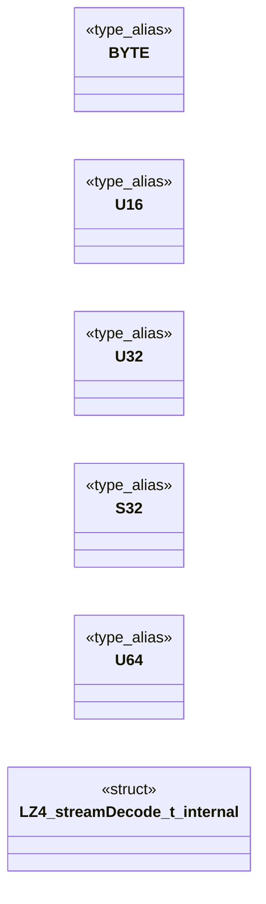

# `lz4.c`

> Source: [lz4.c:1](../../lz4.c#L1) | language `c` | coverage 25.0% | [API index](../index.md)

## Contents

- **Structs:** [`LZ4_streamDecode_t_internal`](#lz4_streamdecode_t_internal)
- **Type Aliases:** [`BYTE`](#byte), [`U16`](#u16), [`U32`](#u32), [`S32`](#s32), [`U64`](#u64)
- **Functions:** [`LZ4_decompress_safe`](#lz4_decompress_safe), [`LZ4_decompress_safe_usingDict`](#lz4_decompress_safe_usingdict), [`LZ4_setStreamDecode`](#lz4_setstreamdecode), [`LZ4_decompress_safe_continue`](#lz4_decompress_safe_continue), [`LZ4_resetStreamDecode`](#lz4_resetstreamdecode)
- **Macros:** [`LZ4_ALIGN`](#lz4_align), [`LZ4_ARCH_64`](#lz4_arch_64), [`LZ4_FAST_DEC_LOOP`](#lz4_fast_dec_loop), [`MEMORY_SANITIZER`](#memory_sanitizer), [`LZ4_8_BIT`](#lz4_8_bit), [`LZ4_16_BIT`](#lz4_16_bit), [`LZ4_32_BIT`](#lz4_32_bit), [`LZ4_64_BIT`](#lz4_64_bit), [`LZ4_64K`](#lz4_64k), [`LZ4_MEMORY_USAGE`](#lz4_memory_usage), [`LZ4_MAX_INPUT_SIZE`](#lz4_max_input_size), [`LZ4_COMPRESSBOUND`](#lz4_compressbound)

## Type Diagram



## Call Graph

Solid arrows stay in this module, dashed arrows leave it.


## Structs

<a id="lz4_streamdecode_t_internal"></a>

### `LZ4_streamDecode_t_internal`

`struct` | [lz4.c:52](../../lz4.c#L52)

```c
typedef struct
```

-************************************
 Internal state
************************************

---

## Type Aliases

<a id="byte"></a>

### `BYTE`

`type_alias` | [lz4.c:23](../../lz4.c#L23)

```c
typedef uint8_t BYTE;
```

-************************************
 Basic Types
************************************

---

<a id="u16"></a>

### `U16`

`type_alias` | [lz4.c:24](../../lz4.c#L24)

```c
typedef uint16_t U16;
```

---

<a id="u32"></a>

### `U32`

`type_alias` | [lz4.c:25](../../lz4.c#L25)

```c
typedef uint32_t U32;
```

---

<a id="s32"></a>

### `S32`

`type_alias` | [lz4.c:26](../../lz4.c#L26)

```c
typedef int32_t S32;
```

---

<a id="u64"></a>

### `U64`

`type_alias` | [lz4.c:27](../../lz4.c#L27)

```c
typedef uint64_t U64;
```

---

## Functions

<a id="lz4_decompress_safe"></a>

### `LZ4_decompress_safe`

`function` | [lz4.c:91](../../lz4.c#L91)

```c
int LZ4_decompress_safe(const char* src, char* dst, int compressedSize, int maxDecompressedSize)
```

-************************************
 Core decompression function
************************************

**Parameters**

| Name | Type | Default | Description |
|---|---|---|---|
| `src` | `char*` |  |  |
| `dst` | `char*` |  |  |
| `compressedSize` | `int` |  |  |
| `maxDecompressedSize` | `int` |  |  |

**Returns:** `int`

*Calls:* [`LZ4_decompress_safe_usingDict`](#lz4_decompress_safe_usingdict)

*Called by:* [`LZ4_decompress_safe_continue`](#lz4_decompress_safe_continue)

---

<a id="lz4_decompress_safe_usingdict"></a>

### `LZ4_decompress_safe_usingDict`

`function` | [lz4.c:95](../../lz4.c#L95)

```c
int LZ4_decompress_safe_usingDict(const char* src, char* dst, int compressedSize, int maxDecompressedSize, const char* dictStart, int dictSize)
```

**Parameters**

| Name | Type | Default | Description |
|---|---|---|---|
| `src` | `char*` |  |  |
| `dst` | `char*` |  |  |
| `compressedSize` | `int` |  |  |
| `maxDecompressedSize` | `int` |  |  |
| `dictStart` | `char*` |  |  |
| `dictSize` | `int` |  |  |

**Returns:** `int`

*Called by:* [`LZ4_decompress_safe`](#lz4_decompress_safe), [`LZ4_decompress_safe_continue`](#lz4_decompress_safe_continue), [`LZ4_H_2983827168210`](lz4.h.md#lz4_h_2983827168210)

---

<a id="lz4_setstreamdecode"></a>

### `LZ4_setStreamDecode`

`function` | [lz4.c:189](../../lz4.c#L189)

```c
int LZ4_setStreamDecode(void* streamPtr, const char* dictPtr, int dictSize)
```

**Parameters**

| Name | Type | Default | Description |
|---|---|---|---|
| `streamPtr` | `void*` |  |  |
| `dictPtr` | `char*` |  |  |
| `dictSize` | `int` |  |  |

**Returns:** `int`

---

<a id="lz4_decompress_safe_continue"></a>

### `LZ4_decompress_safe_continue`

`function` | [lz4.c:198](../../lz4.c#L198)

```c
int LZ4_decompress_safe_continue(void* streamPtr, const char* src, char* dst, int compressedSize, int maxDecompressedSize)
```

**Parameters**

| Name | Type | Default | Description |
|---|---|---|---|
| `streamPtr` | `void*` |  |  |
| `src` | `char*` |  |  |
| `dst` | `char*` |  |  |
| `compressedSize` | `int` |  |  |
| `maxDecompressedSize` | `int` |  |  |

**Returns:** `int`

*Calls:* [`LZ4_decompress_safe`](#lz4_decompress_safe), [`LZ4_decompress_safe_usingDict`](#lz4_decompress_safe_usingdict)

---

<a id="lz4_resetstreamdecode"></a>

### `LZ4_resetStreamDecode`

`function` | [lz4.c:205](../../lz4.c#L205)

```c
void LZ4_resetStreamDecode(void* streamPtr)
```

**Parameters**

| Name | Type | Default | Description |
|---|---|---|---|
| `streamPtr` | `void*` |  |  |

---

## Macros

<a id="lz4_align"></a>

### `LZ4_ALIGN`

`macro` | [lz4.c:16](../../lz4.c#L16)

```c
#define LZ4_ALIGN(x)
```

-************************************
 Macros
************************************

---

<a id="lz4_arch_64"></a>

### `LZ4_ARCH_64`

`macro` | [lz4.c:17](../../lz4.c#L17)

```c
#define LZ4_ARCH_64
```

---

<a id="lz4_fast_dec_loop"></a>

### `LZ4_FAST_DEC_LOOP`

`macro` | [lz4.c:18](../../lz4.c#L18)

```c
#define LZ4_FAST_DEC_LOOP
```

---

<a id="memory_sanitizer"></a>

### `MEMORY_SANITIZER`

`macro` | [lz4.c:30](../../lz4.c#L30)

```c
# define MEMORY_SANITIZER
```

---

<a id="lz4_8_bit"></a>

### `LZ4_8_BIT`

`macro` | [lz4.c:36](../../lz4.c#L36)

```c
#define LZ4_8_BIT
```

-************************************
 Constants
************************************

---

<a id="lz4_16_bit"></a>

### `LZ4_16_BIT`

`macro` | [lz4.c:37](../../lz4.c#L37)

```c
#define LZ4_16_BIT
```

---

<a id="lz4_32_bit"></a>

### `LZ4_32_BIT`

`macro` | [lz4.c:38](../../lz4.c#L38)

```c
#define LZ4_32_BIT
```

---

<a id="lz4_64_bit"></a>

### `LZ4_64_BIT`

`macro` | [lz4.c:39](../../lz4.c#L39)

```c
#define LZ4_64_BIT
```

---

<a id="lz4_64k"></a>

### `LZ4_64K`

`macro` | [lz4.c:42](../../lz4.c#L42)

```c
#define LZ4_64K
```

---

<a id="lz4_memory_usage"></a>

### `LZ4_MEMORY_USAGE`

`macro` | [lz4.c:45](../../lz4.c#L45)

```c
#define LZ4_MEMORY_USAGE
```

---

<a id="lz4_max_input_size"></a>

### `LZ4_MAX_INPUT_SIZE`

`macro` | [lz4.c:46](../../lz4.c#L46)

```c
#define LZ4_MAX_INPUT_SIZE
```

---

<a id="lz4_compressbound"></a>

### `LZ4_COMPRESSBOUND`

`macro` | [lz4.c:47](../../lz4.c#L47)

```c
#define LZ4_COMPRESSBOUND(isize)
```

2 113 929 216 bytes

---
