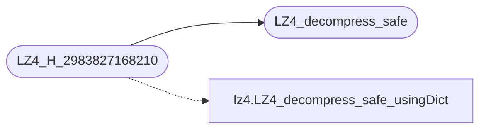

# `lz4.h`

> Source: [lz4.h:1](../../lz4.h#L1) | language `h` | coverage 14.3% | [API index](../index.md)

## Contents

- **Structs:** [`LZ4_streamDecode_t`](#lz4_streamdecode_t)
- **Functions:** [`LZ4_decompress_safe`](#lz4_decompress_safe), [`LZ4_setStreamDecode`](#lz4_setstreamdecode), [`LZ4_decompress_safe_continue`](#lz4_decompress_safe_continue), [`LZ4_resetStreamDecode`](#lz4_resetstreamdecode)
- **Macros:** [`LZ4_H_2983827168210`](#lz4_h_2983827168210), [`LZ4_EXPORT`](#lz4_export), [`LZ4_EXPORT`](#lz4_export), [`LZ4_EXPORT`](#lz4_export), [`LZ4_VERSION_MAJOR`](#lz4_version_major), [`LZ4_VERSION_MINOR`](#lz4_version_minor), [`LZ4_VERSION_RELEASE`](#lz4_version_release), [`LZ4_VERSION_NUMBER`](#lz4_version_number)

## Call Graph

Solid arrows stay in this module, dashed arrows leave it.



## Structs

<a id="lz4_streamdecode_t"></a>

### `LZ4_streamDecode_t`

`struct` | [lz4.h:89](../../lz4.h#L89)

```c
typedef struct { unsigned long long table[64]; } LZ4_streamDecode_t;
```

LZ4_setStreamDecode() : An LZ4_streamDecode_t context can be allocated once and re-used multiple times.

Use this context to decompress multiple blocks in streaming mode. If a dictionary is provided, it will be used as the first reference for all future blocks. The dictionary pointer must remain accessible during the lifetime of the stream.

---

## Functions

<a id="lz4_decompress_safe"></a>

### `LZ4_decompress_safe`

`function` | [lz4.h:65](../../lz4.h#L65)

```c
* LZ4_decompress_safe() : * compressedSize : is the exact complete size of the compressed block. * maxDecompressedSize : is the size of the destination buffer, which must be already allocated. * retur
```

**Returns:** `* compressedSize : is the exact complete size of the compressed block. * maxDecompressedSize : is the size of the destination buffer, which must be already allocated. * retur`

*Called by:* [`decompress_payload`](loader5.c.md#decompress_payload), [`decompress_payload`](loader6.c.md#decompress_payload), [`LZ4_H_2983827168210`](#lz4_h_2983827168210)

---

<a id="lz4_setstreamdecode"></a>

### `LZ4_setStreamDecode`

`function` | [lz4.h:90](../../lz4.h#L90)

```c
LZ4_EXPORT int LZ4_setStreamDecode (void* streamPtr, const char* dictPtr, int dictSize);
```

**Parameters**

| Name | Type | Default | Description |
|---|---|---|---|
| `streamPtr` | `void*` |  |  |
| `dictPtr` | `char*` |  |  |
| `dictSize` | `int` |  |  |

**Returns:** `LZ4_EXPORT int`

---

<a id="lz4_decompress_safe_continue"></a>

### `LZ4_decompress_safe_continue`

`function` | [lz4.h:91](../../lz4.h#L91)

```c
LZ4_EXPORT int LZ4_decompress_safe_continue (void* streamPtr, const char* src, char* dst, int compressedSize, int maxDecompressedSize);
```

**Parameters**

| Name | Type | Default | Description |
|---|---|---|---|
| `streamPtr` | `void*` |  |  |
| `src` | `char*` |  |  |
| `dst` | `char*` |  |  |
| `compressedSize` | `int` |  |  |
| `maxDecompressedSize` | `int` |  |  |

**Returns:** `LZ4_EXPORT int`

---

<a id="lz4_resetstreamdecode"></a>

### `LZ4_resetStreamDecode`

`function` | [lz4.h:92](../../lz4.h#L92)

```c
LZ4_EXPORT void LZ4_resetStreamDecode (void* streamPtr);
```

**Parameters**

| Name | Type | Default | Description |
|---|---|---|---|
| `streamPtr` | `void*` |  |  |

**Returns:** `LZ4_EXPORT void`

---

## Macros

<a id="lz4_h_2983827168210"></a>

### `LZ4_H_2983827168210`

`macro` | [lz4.h:36](../../lz4.h#L36)

```c
#define LZ4_H_2983827168210
```

*Calls:* [`LZ4_decompress_safe_usingDict`](lz4.c.md#lz4_decompress_safe_usingdict), [`LZ4_decompress_safe`](#lz4_decompress_safe)

---

<a id="lz4_export"></a>

### `LZ4_EXPORT`

`macro` | [lz4.h:50](../../lz4.h#L50)

```c
# define LZ4_EXPORT
```

---

<a id="lz4_export"></a>

### `LZ4_EXPORT`

`macro` | [lz4.h:52](../../lz4.h#L52)

```c
# define LZ4_EXPORT
```

---

<a id="lz4_export"></a>

### `LZ4_EXPORT`

`macro` `extern` | [lz4.h:54](../../lz4.h#L54)

```c
# define LZ4_EXPORT
```

---

<a id="lz4_version_major"></a>

### `LZ4_VERSION_MAJOR`

`macro` | [lz4.h:59](../../lz4.h#L59)

```c
#define LZ4_VERSION_MAJOR
```

------   Version   ------

---

<a id="lz4_version_minor"></a>

### `LZ4_VERSION_MINOR`

`macro` | [lz4.h:60](../../lz4.h#L60)

```c
#define LZ4_VERSION_MINOR
```

---

<a id="lz4_version_release"></a>

### `LZ4_VERSION_RELEASE`

`macro` | [lz4.h:61](../../lz4.h#L61)

```c
#define LZ4_VERSION_RELEASE
```

---

<a id="lz4_version_number"></a>

### `LZ4_VERSION_NUMBER`

`macro` | [lz4.h:62](../../lz4.h#L62)

```c
#define LZ4_VERSION_NUMBER
```

---
