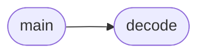

# `unpack.c`

> Source: [unpack.c:1](../../unpack.c#L1) | language `c` | coverage 33.3% | [API index](../index.md)

unpack.c

## Contents

- **Functions:** [`decode`](#decode), [`main`](#main)
- **Variables:** [`outfile`](#outfile)

## Call Graph

Solid arrows stay in this module, dashed arrows leave it.



## Functions

<a id="decode"></a>

### `decode`

`function` `extern` | [unpack.c:5](../../unpack.c#L5)

```c
extern void decode(void);
```

*Called by:* [`main`](#main)

---

<a id="main"></a>

### `main`

`function` | [unpack.c:8](../../unpack.c#L8)

```c
int main(int argc, char *argv[])
```

**Parameters**

| Name | Type | Default | Description |
|---|---|---|---|
| `argc` | `int` |  |  |
| `argv` | `char * []` |  |  |

**Returns:** `int`

*Calls:* [`decode`](#decode)

---

## Variables

<a id="outfile"></a>

### `outfile`

`variable` `extern` | [unpack.c:6](../../unpack.c#L6)

```c
extern FILE *infile, *outfile;
```

---
