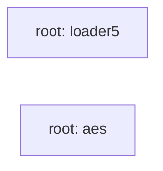

## Details

Static architecture map of 17 files (c, h, py, sh) in 2 components: root: loader5, root: aes. Structure is extracted statically without LLM calls; component prose may be enriched locally.

### root: loader5 (1)

root: loader5 groups 4 files (c, h) around LZ4_H_2983827168210, LZ4_EXPORT, LZ4_EXPORT, LZ4_EXPORT, LZ4_VERSION_MAJOR. EXEC_CTX: Estructuras para ejecución y fluctuación

**Related Classes/Methods**:

- <a href="../lz4.h#L36-L49">lz4.h::LZ4_H_2983827168210</a>
- <a href="../lz4.h#L50-L51">lz4.h::LZ4_EXPORT</a>
- <a href="../lz4.h#L52-L53">lz4.h::LZ4_EXPORT</a>
- <a href="../lz4.h#L54-L58">lz4.h::LZ4_EXPORT</a>
- <a href="../lz4.h">lz4.h::LZ4_VERSION_MAJOR</a>
- <a href="../lz4.h">lz4.h::LZ4_VERSION_MINOR</a>
- <a href="../lz4.h">lz4.h::LZ4_VERSION_RELEASE</a>
- <a href="../lz4.h#L62-L64">lz4.h::LZ4_VERSION_NUMBER</a>

### root: aes (2)

root: aes groups 2 files (c, h) around _AES_H_, CBC, ECB, CTR, AES256. tiny-AES-c (https://github.com/kokke/tiny-AES-c)

**Related Classes/Methods**:

- <a href="../aes.h#L2-L8">aes.h::_AES_H_</a>
- <a href="../aes.h#L9-L11">aes.h::CBC</a>
- <a href="../aes.h#L12-L14">aes.h::ECB</a>
- <a href="../aes.h#L15-L17">aes.h::CTR</a>
- <a href="../aes.h#L18-L19">aes.h::AES256</a>
- <a href="../aes.h#L20-L22">aes.h::AES_BLOCKLEN</a>
- <a href="../aes.h">aes.h::AES_KEYLEN</a>
- <a href="../aes.h#L24-L25">aes.h::AES_keyExpSize</a>
